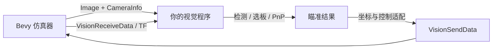

# ROS2 接口说明

## 数据流与职责



仿真器只提供场景、传感器和执行机构。视觉程序负责检测、解算、时间有效性判断与坐标转换。消息的 `header.frame_id` 是语义标记，不会替发送方自动做坐标变换。

## 话题一览

| 话题 | 类型 | 方向 | 主要语义 |
| --- | --- | --- | --- |
| `/image_raw` | `sensor_msgs/msg/Image` | 仿真器发布 | 默认 1440x1080、`rgb8`、Reliable |
| `/camera_info` | `sensor_msgs/msg/CameraInfo` | 仿真器发布 | 与当前分辨率/FOV 配套的内参与零畸变 |
| `/vision_receive_data` | `rm_interfaces/msg/VisionReceiveData` | 仿真器发布 | 当前 roll/pitch/yaw、弹速等；SensorData QoS |
| `/vision_send_data` | `rm_interfaces/msg/VisionSendData` | 仿真器订阅 | 绝对云台角与目标状态；SensorData QoS |
| `/tf` | `tf2_msgs/msg/TFMessage` | 仿真器发布 | `map -> odom -> gimbal_link -> camera_link -> camera_optical_frame` 等关系 |
| `/simulator/marker` | `visualization_msgs/msg/Marker` | 仿真器发布 | 真值调试辅助，不应作为正常检测输入 |

`/gimbal_pose`、`/camera_pose` 等 PoseStamped 在当前实现中位置字段可能是占位信息；真实姿态优先使用 `/vision_receive_data` 或核实后的 TF 链。

## 图像与相机

- 默认图像：1440x1080、`rgb8`。
- 默认垂直 FOV：45 度。
- 默认近似内参：`fx=fy=1303.6753`、`cx=720`、`cy=540`，畸变系数为 0。
- 修改分辨率或 FOV 后，必须使用新的 `/camera_info`，不能继续沿用默认数值。
- 时间戳来自系统墙钟；本仓库不要求也不建议随意启用 `use_sim_time`。

Python 订阅 QoS 示例：

```python
qos = QoSProfile(depth=1, reliability=ReliabilityPolicy.RELIABLE)
node.create_subscription(Image, '/image_raw', callback, qos)
```

实时视觉应尽量消费最新帧，避免处理能力不足时旧帧持续积压。接收 FPS 和算法处理 FPS 应分别记录。

## 云台反馈

`VisionReceiveData` 中接入最常用的字段：

| 字段 | 单位/含义 |
| --- | --- |
| `roll` | 当前横滚角，度 |
| `pitch` | 当前俯仰角，度 |
| `yaw` | 当前航向角，度 |
| `bullet_speed` | 仿真配置中的弹速，当前消息字段为 `uint8` |
| `self_color` | 当前受控红方场景固定为 0，不代表已支持任意队伍自动识别 |

该话题使用 SensorData QoS（Best Effort、深度小）。命令适配器应给反馈设置超时，不能永久使用最后一次姿态。

## 云台命令

`VisionSendData` 中当前仿真器实际使用的关键字段：

| 字段 | 单位/含义 |
| --- | --- |
| `yaw` | 世界参考下的绝对 yaw，度；当前约定左正 |
| `pitch` | 绝对 pitch，度；当前约定下正；仿真器内部写入 Bevy 时反号 |
| `target_state` | 0=无效/停止追踪，1=有效且不射击，2=有效并请求射击 |
| `target_distance` | 目标距离，示例统一使用米；`-1.0` 表示无效 |
| `control_id` | 可选控制序号，便于调试 |

`delta_yaw`、`delta_pitch` 等字段不是当前基线的主要控制输入。`target_state=2` 按请求上升沿并受限频处理；最小接入时保持 `target_state=1`，不要测试射击。

仿真器保存最近的有效目标角，并以限速方式继续趋近目标。因此“停止发布”不等于“停止追踪”。正常失效时应持续短暂发布：

```text
target_state = 0
target_distance = -1.0
yaw/pitch = 最近一次有效反馈（如可用）
```

客户端崩溃或被强制杀死时，退出保护可能无法执行；此时在窗口中按 `F5` 关闭自动控制。

## 从视觉结果到命令

不要把 PnP 输出不加判断地直接填入 `yaw/pitch`。先明确自己的输出属于哪一种：

1. 相机坐标中的像素/角度误差：需要结合当前反馈和方向约定换成绝对角。
2. 相机坐标中的三维目标点：需要通过相机外参/TF 旋转到所需参考系，再求绝对角。
3. 已经是世界系绝对角：核对单位和正负号后可直接发布。

仓库的最小适配器只覆盖第一种的小角度近似：

```text
command_yaw   = feedback_yaw   - clamp(right_positive_yaw_error)
command_pitch = feedback_pitch - clamp(up_positive_pitch_error)
```

它带有 0.15 度死区、单次 2 度限幅、视觉结果/反馈 200 ms 超时，并且同一结果只计算一次修正。参数可通过 ROS2 参数调整，但应先用固定命令验证物理方向。

## 接入验收顺序

1. `image_probe.py` 能持续收到图像和匹配的 CameraInfo。
2. `gimbal_probe.py` 的小幅绝对角命令方向正确，结束后停止状态有效。
3. 视觉程序开环运行，确认 RGB/BGR、内参、装甲尺寸、角点顺序和距离单位。
4. 只保留一个命令发布者，静止目标、小偏角启用闭环。
5. 依次测试无目标、PnP 失败、图像中断、反馈中断；都不得继续把旧结果当成有效目标。
6. 最后再测试目标运动和己方运动；本仓库不替用户实现预测、EKF、惯性补偿或弹道模型。

## 排查要点

| 现象 | 检查 |
| --- | --- |
| 图像正常但颜色检测失败 | `rgb8` 到 BGR 的转换与颜色阈值 |
| 距离或角度明显错误 | CameraInfo、分辨率/FOV、装甲尺寸/单位、四角点顺序 |
| 有消息但云台不动 | `F5`、`target_state`、`target_distance`、重复发布者 |
| 云台越转越偏 | 正负号、度/弧度、绝对角/相对误差、参考系 |
| 越来越延迟 | 队列深度、是否消费最新帧、接收与处理 FPS |
| 退出后仍跟踪 | 是否发送无效目标；强退时用 `F5` |
| PoseStamped 总为零 | 改用反馈或核实 TF，不把占位话题当真实姿态 |
