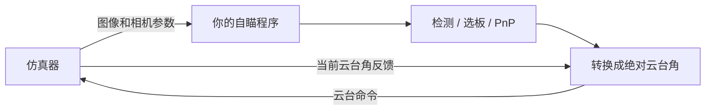

# ROS2 接口说明

本文帮助你把已有自瞄程序接入仿真器。第一次接入时，请先完成根目录 README 中的图像测试和固定云台命令测试，再阅读具体字段。

## 1. 数据怎样流动



仿真器负责生成画面和执行云台运动。你的程序负责识别目标、判断结果是否有效，并把结果转换为正确的命令。

`frame_id` 只是在消息中说明数据属于哪个坐标系，不会自动替你转换坐标。

## 2. 需要使用的话题

| 话题 | 消息类型 | 你需要做什么 |
| --- | --- | --- |
| `/image_raw` | `sensor_msgs/msg/Image` | 订阅虚拟相机图像 |
| `/camera_info` | `sensor_msgs/msg/CameraInfo` | 订阅与当前画面匹配的相机内参 |
| `/vision_receive_data` | `rm_interfaces/msg/VisionReceiveData` | 读取当前云台角度 |
| `/vision_send_data` | `rm_interfaces/msg/VisionSendData` | 发布绝对云台角和目标状态 |
| `/tf` | `tf2_msgs/msg/TFMessage` | 需要完整坐标转换时读取坐标关系 |
| `/simulator/marker` | `visualization_msgs/msg/Marker` | 只用于真值调试，不要作为正常检测输入 |

可以用下面的命令查看某种消息包含哪些字段：

```bash
source scripts/env.sh
ros2 interface show rm_interfaces/msg/VisionSendData
```

## 3. 图像与相机参数

默认图像参数：

```text
宽高：1440 x 1080
编码：rgb8
垂直视场角：45 度
畸变：0
```

默认内参约为 `fx=fy=1303.6753`、`cx=720`、`cy=540`。这些数值只适用于默认分辨率和视场角。

正确做法是订阅 `/camera_info`，把其中的 `K` 和 `D` 交给 PnP。这样修改分辨率或视场角后，不需要手工改一组旧参数。

仿真器输出 `rgb8`，而 OpenCV 常用 BGR。使用 `cv_bridge` 时可以直接转换：

```cpp
cv_bridge::toCvCopy(msg, "bgr8")->image;
```

实时处理时让队列保持较小，并优先处理最新帧。否则即使程序一直在运行，控制也可能因为处理旧图像而越来越迟。

## 4. 当前云台角反馈

从 `/vision_receive_data` 读取：

| 字段 | 含义 |
| --- | --- |
| `yaw` | 当前 yaw，单位度 |
| `pitch` | 当前 pitch，单位度 |
| `roll` | 当前 roll，单位度 |
| `bullet_speed` | 当前仿真弹速 |

这个话题使用 SensorData QoS。Python 中可以直接使用：

```python
from rclpy.qos import qos_profile_sensor_data
```

不要永久保存并使用最后一次反馈。超过你的超时时间仍没有收到新反馈时，应停止输出有效目标。

## 5. 发送云台命令

向 `/vision_send_data` 发布 `VisionSendData`。当前仿真器真正使用的主要字段是：

| 字段 | 怎样填写 |
| --- | --- |
| `yaw` | 绝对角，单位度；当前约定向左为正 |
| `pitch` | 绝对角，单位度；当前约定向下为正 |
| `target_state` | `0` 无效，`1` 有效但不射击，`2` 请求射击 |
| `target_distance` | 目标距离，示例使用米；无效时填 `-1.0` |
| `control_id` | 可选的命令序号，便于查看日志 |

这里的“绝对角”表示命令中填写云台最终应朝向的角度，而不是“再向左转多少度”。

例如当前反馈为 `yaw=10°`，目标在画面右侧 2°。按照本仓库的约定，新的绝对命令约为：

```text
10° - 2° = 8°
```

请先用 `gimbal_probe.py` 在实际画面中确认正负方向，再采用这个关系。若越转越偏，通常是正负号、角度单位或绝对角/相对误差混淆。

`delta_yaw` 和 `delta_pitch` 不是当前版本的主要控制输入。第一次接入时不要使用它们。

## 6. 目标无效时怎么做

以下任一情况出现时，都不要继续发送旧目标：

- 没检测到目标；
- PnP 求解失败；
- 图像已经过期或中断；
- 云台反馈已经过期；
- 结果中出现 NaN、无穷大或不合理距离。

应发送：

```text
target_state = 0
target_distance = -1.0
```

如果仍有新鲜的云台反馈，可以把当前反馈角写入 `yaw/pitch`。仿真器收到无效目标后会清除追踪目标并保持姿态。

仅停止发布不等于停止追踪，因为仿真器会保存最近的有效目标角。正常退出程序前应连续发送几次无效目标；程序崩溃或被强制结束时，在仿真器窗口按 `F5` 关闭自动控制。

## 7. 怎样选择转换方法

先确认你的自瞄程序输出什么：

### 输出是画面中的角度误差

小角度、相机与云台近似对齐时，可以参考：

```text
命令 yaw   = 当前 yaw   - 右正 yaw 误差
命令 pitch = 当前 pitch - 上正 pitch 误差
```

仓库中的 `aim_adapter.py` 就是这种入门示例，并带有限幅、死区和超时保护。

### 输出是相机坐标中的三维目标点

先用相机外参或 `/tf` 把目标方向转换到需要的参考系，再计算绝对 yaw/pitch。不要直接把三维坐标或相机系角度塞进绝对角字段。

### 输出已经是世界系绝对角

核对单位为度、方向与本文一致后，可以直接发布。

## 8. 推荐测试顺序

1. 运行 `image_probe.py`，确认图像、编码、CameraInfo 和接收帧率。
2. 运行 `gimbal_probe.py`，确认绝对角、单位和正负方向。
3. 让你的算法开环处理图像，只观察检测与 PnP 结果。
4. 只保留一个命令发布者，在静止目标和小偏角下打开闭环。
5. 分别制造无目标、PnP 失败、图像中断和反馈中断，检查云台不再使用旧结果。
6. 最后测试移动目标或己方运动。

如果静止场景仍不能稳定，不要急着加入预测、EKF 或复杂控制器。先排除图像积压、相机参数、装甲尺寸、角点顺序、单位和正负号问题。
